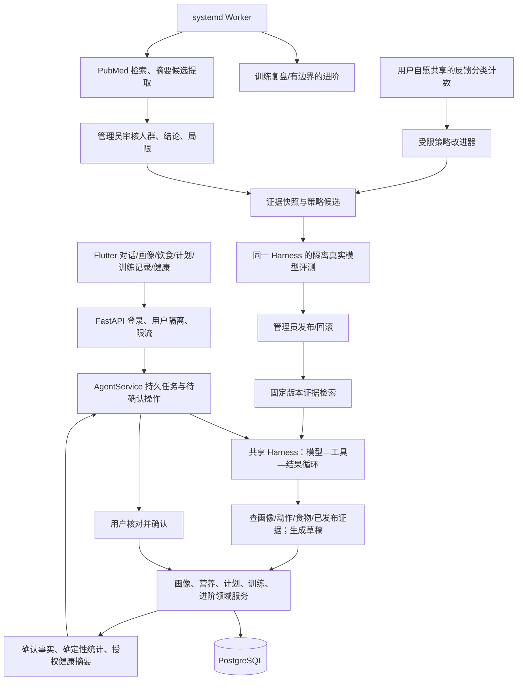

# 练伴 0.3：私教 Agent、业务上下文与研究闭环

> 版本说明：本文是0.3 Agent/研究基础说明。0.5.1的授权、周期、营养、完整目录与检索扩展以[当前架构](ARCHITECTURE_AND_AI.md)和[开发状态](DEV_STATUS.md)为准。

## 1. 现在的架构

仍然是可维护的模块化单体，没有引入微服务、向量数据库或训练模型。在线 Agent 与离线 Worker 共享模型网关和 Harness，业务写入使用既有用户隔离与数据库事务。旧接口兼容保留，主聊天页面已经改用 `/api/agent/runs`。

### 代码边界

| 目录/文件 | 责任 |
| --- | --- |
| `backend/agent.py` | 用户任务、固定上下文/知识版本、检查点、恢复、待确认操作、幂等提交、反馈 |
| `backend/services/agent_harness.py` | 真正的工具调用循环、工具白名单、参数反馈、调用/时间/上下文预算；线上和评测共用 |
| `backend/services/model_gateway.py` | DeepSeek 等兼容 Chat Completions 的请求、工具调用、结构化输出、延迟与 token 用量、嵌套调用预算 |
| `backend/services/context.py` | 缩小任务上下文，避免整段历史与原始测量序列全部进入提示词 |
| `backend/services/nutrition.py` | 确定性营养计算、餐次记录、幂等、完整度 |
| `backend/health_data.py` | 来源可追溯的测量、导入、去重、授权、趋势、恢复反馈 |
| `backend/workouts.py` / `progression.py` | 确认训练事实、统计、复盘、有边界的渐进负荷与版本撤销 |
| `backend/research.py` / `services/research_store.py` | 论文、证据、审核、候选、评测、发布和回滚 API |
| `backend/services/literature.py` | 固定 NCBI 官方地址检索；来源哈希、摘要范围、撤稿标记 |
| `backend/services/evaluation.py` | 冻结合成场景、确定性检查、模型评分、基线/候选比较 |
| `backend/services/research_worker.py` / `scripts/agent_worker.py` | 有租期的任务领取、订阅、受限优化、训练后续任务 |

## 2. 私教如何执行请求

1. 服务端绑定登录用户，保存 request_id、画像/训练/授权版本、最近对话、紧凑上下文和当前知识版本。
2. 模型按需调用 `get_user_context`、`search_foods`、`search_exercises`、`search_evidence`。
3. 写入请求使用 `propose_meal`、`propose_workout` 或 `propose_plan`，产出可核对的草稿。模型没有任意 SQL、网络访问或发布权限。
4. App 展示食物/份量/餐次、实际逐组训练或完整计划，用户确认才调用 decision 接口写入。取消不会写正式记录。
5. 确认复用同一操作编号，餐次/训练/AI计划按编号幂等。账户、会话、画像或计划变化会在相关写入时重新检查。
6. 确认的训练自动排队复盘；关联当前计划的训练再评估进阶，结果进入训练记录与对话。未关联计划不会据此修改计划。
7. 失败任务保留步骤，可恢复；工具批次恢复会补齐已有 tool_call_id，避免丢失工具结果。

每任务最多5轮 Agent 模型请求、10次工具调用、每轮最多4个工具、约95秒在线时限、约7万字符上下文；包含计划生成的嵌套模型网关预算为7次请求与约3万已报告 token。未知用量保留为空，未伪造人民币费用。HTTP 仍有每账号每分钟6次、每天100次及并发租约限制。研究另有每日任务预算。

临时周计划使用 `scope=this_week`，可临时指定训练日和时长，不改长期画像；到北京时间本周日结束后，恢复最近未过期的长期计划。首次使用仍保留画像引导和计划确认。

## 3. 提示词与事实边界

`backend/prompts/fitness_coach.md` 是共同身份/画像提取规则，四种性格保留于 `backend/coaches.py`；`agent.md` 描述工具、确认、引用和权限；`plan.md`、`review.md`、`progression.md` 分别对应任务约束，版本清单为 `versions.json`。Schema、用户上下文和工具描述在服务端动态补充。

- 事实只来自用户当前明确陈述、已确认记录及授权测量；每条长期画像提取须附本次原话。临时限制放恢复反馈或临时计划，不自动变成永久偏好。
- 模型建议、设备估算、确定性统计与确认事实分开保存。对话不把普通训练组写成RM，不凭单次设备数据修改RM或营养目标。
- 引用只能来自实际检索返回的已发布条目，最终引用ID再次核对。无法命中时说明无发布证据。
- 撤销审核、撤稿或来源被新版替代后，该证据停止进入后续检索；发布时再次检查。不是完整的全球撤稿监控，需重新检索或人工维护来源状态。
- 研究和工具文字均是资料，不可变更工具权限、系统提示或校验器。发布策略只允许回答风格、检索条数、澄清数量；不能改程序、健康规则和评测。

## 4. 新业务数据与价值

| 数据 | 如何使用 | 限制 |
| --- | --- | --- |
| 工作组/热身组、辅助完成、RIR、实际休息 | 解释表现和训练刺激；工作组统计 | 热身与辅助完成不作独立达标依据 |
| 器械标识、负重口径、不适部位 | 只对比可比条件，定位下次需关注的动作 | 换器械/口径不直接据此加重 |
| 完成原因、补充、实际起止时间 | 区分时间、器械、疲劳与动作不适 | 未填写保持未知，不自动推断 |
| 饮食完整度、份量来源 | 正确解释当天摄入与目标差值 | 未完整记录不能断言全天吃少了；修改餐次会撤销“完整”标记 |
| 过敏、做饭条件、预算、外食频率 | 让饮食建议可执行 | 自述，不诊断过敏或疾病 |
| 睡眠感受、精神、疲劳0–10、不适变化、临时限制 | 决定需要追问什么，辅助恢复建议 | 不直接改长期画像；不凭单次反馈自动加重 |
| 体重、腰围、体脂、步数、睡眠、静息心率、HRV、活动分钟与消耗 | 带日期、来源与条件的近7天/前7天摘要 | 每个指标选择同来源条件，按日取最新，不合并重叠设备；两窗口各至少3天才比较 |

测量保留 provider、external_id、设备、来源App、测量方法/条件、时区、观察区间和来源更新时间。相同用户/来源/external_id去重，来源更新需更晚的更新时间；批量导入原子提交。手填/文件导入的厂商来源未经厂商验证，不冒充官方同步。体脂/BIA/活动热量明确标为估算。缺失不作为0。

保存授权与AI摘要授权分别开关，默认关闭；关闭后停止新健康摘要进入模型。测量可逐条/全部删除，账号导出包含测量，删号按外键级联清除。过去用户已授权发送的对话与任务快照属于历史记录，不因仅删除测量而自动抹除；删号会清除这些个人记录。

**本轮可用：手动记录、JSON文件导入、趋势与恢复反馈。** Health Connect、荣耀健康、华为健康、Withings目前显示未接通；需确定设备、厂商权限和原生桥接后实施自动同步。不收集无业务用途的连续秒级原始传感器流，也不保存与健身无关的对话资料。

## 5. 研究与自动评测闭环

1. 管理员手工检索，或明确开启每日订阅（默认关闭），每次1–5篇，默认3篇。检索与摘要来自 PubMed ESearch/EFetch。
2. 固定来源地址、有限响应大小、来源哈希与摘要范围。模型仅提取候选结论/PICO/局限；原文片段须属于摘要且不超过25个英文单词。失败可重试，撤稿来源排除，不假装读取全文或自动给出证据等级。
3. 管理员核对后审核；候选版本冻结策略、证据快照、基线版本和指纹。
4. Worker 使用**同一个工具循环**分别运行当前基线和候选。隔离工具只读合成画像与证据，所有操作只保存于内存，不写用户饮食、计划或训练。
5. 七类场景覆盖完整训练草稿、称重饮食草稿、缺RPE澄清、提示注入、设备数据误用、研究依据和实际画像读取。确定性检查操作/参数/引用/提取；模型评分检查事实依据与可执行性。
6. 候选须所有硬检查通过、7项质量检查通过且不低于基线。评分覆盖不足或模型失败都不能发布。
7. 只有对应指纹、对应基线的通过报告才可发布；发布使用数据库全局锁防止多管理员覆盖。发布后新任务读取新知识版本，旧任务保留其快照；可回滚当前版本。
8. 用户可给回复反馈；只有显式勾选共享的**分类计数**进入自动优化。管理员可开启自动改进：新增已审核证据，或累计至少5条新的授权反馈后，每天最多触发一次。优化器生成白名单策略候选并排队评测，管理员仍须决定是否发布；默认关闭，也可手动运行。

当前自动评测是小规模回归门禁，每场景每版本一次运行；模型评审尚需持续人工校准。它不证明长期训练效果、临床安全或运动科学结论正确。后续扩充专家标注集、真实匿名授权案例、多次采样和长期成效验证时，先冻结新评测版本再比较，优化器不能修改题目或评分器。

## 6. 配置与运行

- 既有 `AI_API_KEY`、`AI_BASE_URL`、`AI_MODEL` 继续使用，模型须同时支持tools与JSON输出；Key只在后端。
- 新配置 `NCBI_CONTACT_EMAIL`（建议填写运营联系邮箱），`NCBI_API_KEY`（可选）；默认频率无需Key。每日检索与自动改进在管理员页分别开启，默认都关闭。
- PostgreSQL执行 `python -m alembic upgrade head`，本次新增 `health_measurements`、`research_records`；用户任务/反馈仍使用隔离的 `user_records`。
- 本机：`python scripts/agent_worker.py` 执行一轮；服务端安装脚本包含 `liftlab-agent.service/.timer`，每分钟领取一个研究任务，并处理少量训练后续任务，不重叠。
- 每天最多8项研究任务、其中最多2次完整评测；每次完整评测网关上限52次调用/18万已报告token，1200秒。单次摘要/策略任务上限5次调用/2.5万已报告token。并非每次都会用满；按运营预算另设供应商余额告警。
- 管理员账号由运维命令 `python scripts/manage_account.py promote --user-id <已确认账号UUID>` 授予；普通账号只能看已发布知识。刷新登录以取得新角色界面。
- 查看后台：`systemctl status liftlab-agent.timer`、`journalctl -u liftlab-agent.service -n 50`；任务状态与评测详情也在App管理员页。

SMTP、微信移动应用资质、照片营养识别、经验证的动作纠错仍按原配置边界处理；本轮架构升级没有把未接入功能标为完成。

## 7. 验证清单

后端覆盖授权、来源去重、原子导入、用户隔离、营养完整度、Agent幂等确认/失败恢复/引用拒绝、热身/辅助限制、证据审核/发布/撤稿/回滚、论文提取重试和共享Harness隔离。Flutter覆盖确认操作、健康双授权和普通账号知识可见性，并运行既有画像/计划/训练/登录测试。上线前在独立PostgreSQL数据库迁移、运行测试与真实模型验收，不能把测试脚本连接生产用户库。

### 本次实际验收（2026-10-19）

- 本机后端与打包测试：102通过、2项PostgreSQL专用测试跳过；服务器独立PostgreSQL库后端101项全部通过，测试库已删除。
- Flutter：33项测试通过，analyze无问题；Web和Android ARM64 release均构建成功。
- 使用真实DeepSeek和PubMed验证了饮食草稿/幂等确认、训练草稿/后台复盘、健康双授权、摘要提取、七场景基线/候选评测、发布/回滚、反馈优化排队。测试数据与测试论文未写入生产用户库。
- 已升级云端后端与数据库，安装并实际启动了后台Worker；研究订阅与自动改进默认关闭。生产知识库从空版本开始，首批论文需要管理员审核发布。
- Android版本0.3.0+5，包名与正式签名保持原身份。APK SHA256：`dabf4886434cd8916f46583536048568125f0187686238e6b55ecbf25a369bd3`。已更新私有下载，未连接手机做本次真机安装。
- 手表/体脂秤自动同步、扩大并人工校准评测集、长期训练成效验证仍需后续实施。

官方接口资料：[DeepSeek工具调用](https://api-docs.deepseek.com/guides/tool_calls/)、[NCBI E-utilities](https://www.ncbi.nlm.nih.gov/books/NBK25499/)、[Android Health Connect](https://developer.android.com/health-and-fitness/health-connect/data-types)。
