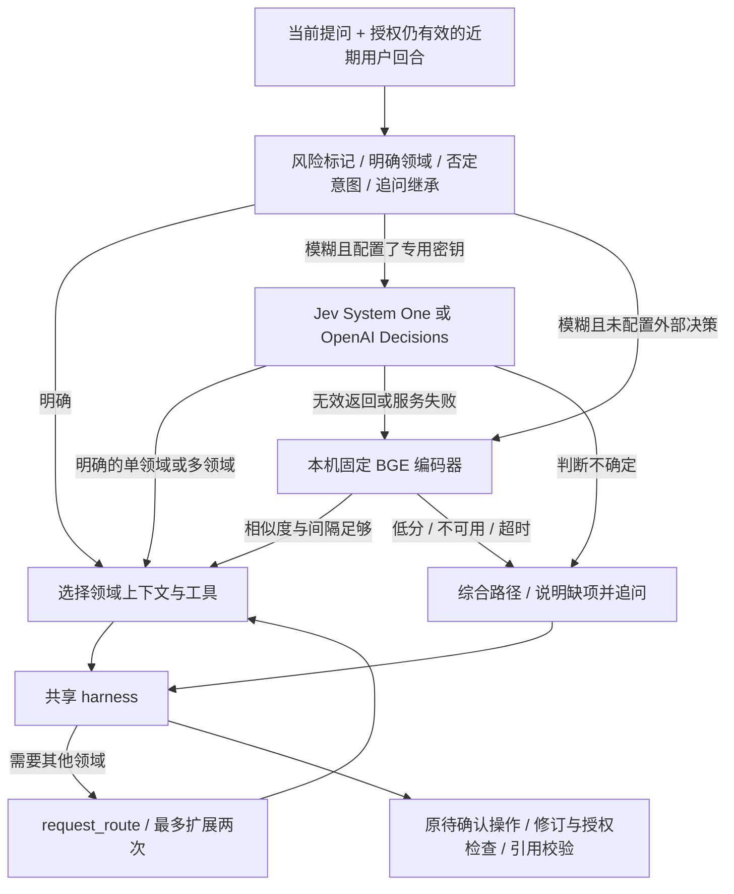

# 私教问题分层路由（本地 2026-10-30）

主聊天 `POST /api/agent/runs` 按健康恢复、训练计划、饮食营养、实际训练/动作、知识研究、个人画像和综合问题分流。路由使用同一套有检查点的 harness，在每个领域选择资料、提示和工具；跨领域取并集，不强迫用户选一个分类。



## 1. 漏斗的每一层

1. **确定性初筛**：保留健康/不适和不可信指令标记，多领域匹配；识别“不关联计划、不修改画像”等明确否定，避免无关工具与资料进入。明确寒暄走最小上下文；“结合我的记录给出整体建议”等综合请求保留完整路径。短追问可继承上一条授权仍有效的用户回合的路由，明确新话题优先。
2. **专用决策模型（可选）**：仅在规则无法明确分流时发送当前提问，一次并行判断七个领域。Jev 使用 `POST https://api.typesafe.ai/v1/systemone` 的 Noul；OpenAI 使用 `POST https://api.openai.com/v1/decisions` 的 predicate。模型返回逐领域概率，支持多领域。默认 `>=0.8` 为明确命中，任何领域处于 `[0.3,0.8)` 则保留综合路径；这些是初始工程阈值，尚无第三方模型的业务校准/准确率验收。
3. **本地语义后备层**：复用已固定 revision/SHA 的 BGE 中文 ONNX 编码器，与代码内公开领域例句比较余弦相似度，分数 `>=0.60` 且领先第二名 `>=0.04` 才缩小范围。余弦相似度不是概率。最多处理500字，超长请求不截断后冒充理解完整；模型缺失、低分、繁忙或1.5秒超时保留综合路径。编码器只在本机运行，当前提问及向量不写 Redis、知识片段或公共索引；仅公开例句向量进程内复用。
4. **专项 harness**：按领域提供上下文、动作/食物查询及待确认工具，复用原教练性格、结构化输出、事实提取及引用校验。需要补充领域时可调用 `request_route`，在同一任务最多扩展两次，重新检查授权/资料并取所需上下文。扩展本身不写训练/饮食/计划事实。

外部服务网络或HTTP失败时回到本地层；原生拒答、缺失/重复答案、非数值/NaN/越界概率属于无效决策，保留诊断后回退。外部HTTP总超时2秒，无自动重试，失败熔断15秒；本地层用非阻塞锁限制积压。专用决策并不替代通用模型回答，也不作为临床风险判定。

## 2. 各领域取得什么

| 领域 | 主要资料 | 业务工具 |
|---|---|---|
| 健康恢复 | 相关画像、授权健康/活动度摘要、确认训练记忆 | 读当前领域资料，查动作及公开知识/证据 |
| 训练计划 | 画像、胸背腿力量、有效RM、当前计划、确认训练、授权恢复摘要、日程 | 查询动作、生成原有计划草稿 |
| 饮食营养 | 相关身体/目标/过敏及饮食条件、当天营养目标与日记状态 | 查食物、整理饮食待确认草稿 |
| 实际训练/动作 | 相关画像/力量/RM/计划、确认训练记忆、授权恢复摘要、相关动作 | 查动作与教学、整理实际训练待确认草稿 |
| 知识研究 | 少量相关动作资料 | 查公开知识、真实节点及已发布研究，查看具体动作资料 |
| 个人画像 | 已确认画像、力量资料、提醒设置 | 读资料，沿原规则提取当前消息的明确事实 |
| 综合 | 完整的授权后紧凑上下文 | 原工具集及按需扩展 |

明确寒暄仅有教练身份、日期等基本资料和读取/扩展工具。未加载的健康/活动度字段带 `omitted_for_route=true`，不代表用户没有记录或撤回授权。饮食问题不附带无关计划/RM/训练历史；与当前领域无关的旧回答也会过滤，包括外部决策在初始综合快照上进一步缩小时的历史。

专项训练/计划上下文不预先注入完整动作目录，使用 `search_exercises` 核对ID和重量口径。搜索返回有限身份、器械、关节/部位与来源/推断审核状态；需要教学时再调用 `get_exercise_details` 读取对应动作完整资料。源目录、动作ID和实际记录校验保持原样，展示素材不自动成为动作检测能力。

## 3. 配置 Jev / OpenAI

当前本机专用密钥未配置，运行模式为 **规则 + 本地语义 + 专项 harness**。原生HTTP接口已经适配并用隔离 transport 测试，但不能宣称 Jev/OpenAI 真实调用已验收。

将专用配置写入本机环境或受保护的 `.env`，不要发到聊天或提交Git：

| 配置 | 含义 |
|---|---|
| `AGENT_ROUTING_MODE=hybrid` | 启用漏斗；`rules`关闭外部决策和本地语义推理，仍保留领域工具/上下文与综合后备 |
| `AGENT_DECISION_PROVIDER=auto` | 有 `OPENAI_API_KEY` 用 OpenAI，否则有 `TYPESAFE_API_KEY`/`JEV_API_KEY` 用 Jev，否则本地；也可明确指定 `openai`、`jev` 或 `local` |
| `OPENAI_API_KEY` | OpenAI专用API key；默认决策模型 `gpt-6-luna` |
| `TYPESAFE_API_KEY` | Jev专用API key（兼容别名 `JEV_API_KEY`）；默认固定 `jev-1.14.0` |
| `AGENT_DECISION_MODEL` | 留空使用对应默认模型；有意更换时需重验其协议与效果 |

只向两个固定官方 HTTPS 端点发请求，禁止重定向；不会把原聊天供应商的 `AI_API_KEY` 复用给另一家。只选择一个已配置的外部决策供应商，不在一次失败中轮流向不同服务发送提问。供应商接收的是用户本次提问，画像、历史聊天、健康摘要和训练记忆不附加给决策服务。原回答模型继续使用 `AI_*` 配置和所需的授权上下文。

参考 [OpenAI Decisions 指南](https://developers.openai.com/api/docs/guides/decisions)、[原生请求/响应参考](https://developers.openai.com/api/reference/resources/decisions/methods/create)、[TypeSafe Jev Quick Start](https://docs.typesafe.ai/introduction/quickstart)、[Noul 类型](https://docs.typesafe.ai/primitives/noul)。用户提供的 [Jev 概览](https://jevai.net/) 用于定位模型，实现协议以这两家官方API文档为准。

```powershell
.\.venv\Scripts\python.exe scripts/agent_router_status.py
```

已登录用户也可读取 `GET /api/agent/routing/status`。它只返回模式、可配置性、本机素材是否存在；配置密钥不等于账号具有接口权限。修改配置/代码后先核实并重启本工作区后端，`start.ps1` 在8000已监听时不热重载。

## 4. 授权、恢复和验收边界

- 路由结果在私有 `agent_run.routing` 中审计，API返回领域、阶段、耗时、风险标记及决策依据元数据；它是推断，不能写为用户事实/RM/诊断。按owner隔离，保持原画像原文依据校验。
- 每次模型调用、外部决策前后和工具执行/扩展都核对当前资料与授权修订。健康/活动度的独立授权、历史回复过滤、计划力量必填、确认启用及训练/饮食待确认机制继续生效。
- 实际提供的工具白名单持久化到模型步骤。模型未获提供的工具在正常执行和中断批次恢复中都不能直接调用；扩展后的新工具在后续模型回合提供。
- 外部决策算入原有共享模型/Token预算，HTTP前记录尝试，失败也留审计；恢复不会重复一条可能已计费但中断的决策请求。原5次主模型、10次工具、7次共享模型与30000 Token门槛没有上调。
- 路由策略/供应商/模型或harness版本变化后，旧未完成任务需重新提问。原已保存的计划和训练不改写，原待确认操作仍由原业务确认校验处理。
- 7项固定工作流评测使用同一领域/工具规则；其题目、评分与知识发布门槛保持，版本标记 `coach-regression-2026-10-v3-routing`。它验证工作流，不替代外部决策准确率评测。

本机实际测试、失败与最终交付见 [DEV_STATUS](DEV_STATUS.md)。16条本地语义合成开发样例、真实聊天模型烟雾及完整后端测试分别记录；合成样例包含保守综合后备，不把它们当作分类准确率。新源码/提示词使旧知识评测不能用于未来发布绑定；V2活动指针不变，本轮未重新发布知识、部署云端或构建APK。
