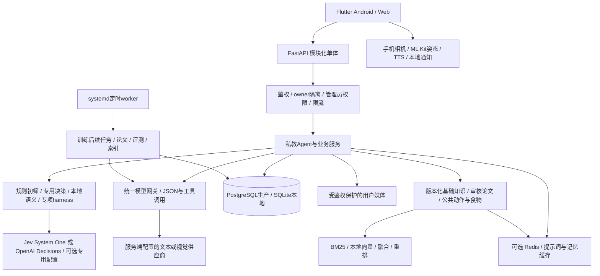
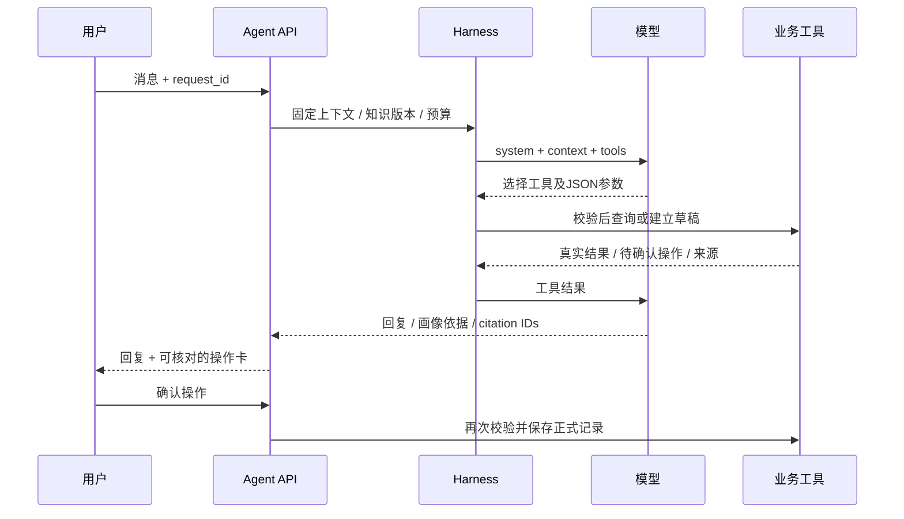

# 练伴：当前架构与AI交互

核对日期：2026-10-30；代码0.5.1，Android 0.5.1+8。本文描述当前工作区，云端及测试差异见[DEV_STATUS.md](DEV_STATUS.md)。旧说明已保存在[历史架构](history/ARCHITECTURE_PRE_0_5.md)，不再用旧“单轮聊天、无工具权限”的描述解释主聊天。

各模块的“待完善”描述目标设计和验收缺口，不代表已经实现；需求ID及验收标准见[PRD](PRD.md)。P0为发布前验证/数据边界问题，P1为核心体验完善，P2为后续扩展。最近六项训练与目录扩展仅在本地实现，未因此同步云端或APK。

## 1. 总体架构

这是模块化单体，不是微服务系统。后台任务使用数据库记录与systemd worker；Redis 只作为可选读取缓存，没有引入 Celery 或独立托管向量数据库。本地ONNX推理和可选pgvector已实现，但不代表当前云端已完成这套运行时部署。

2026-10-29 本地增加 `services/cache.py`：提示词 L1/Redis、owner 隔离的画像事实/训练记忆缓存，以及版本/撤回/管线绑定的公开知识结果缓存。私有数据依赖 SQL nonce 和账号状态，授权/修订照常即时核对；写入事务先更新 nonce，提交后清理，回滚不发布未提交内容。正文加密、key HMAC，Redis 故障回到 SQL/文件；显式评测绕过知识结果缓存。技术版本使用既有 `user_records.cache_meta`，不新增表。详细 TTL、故障/注销边界及本机运行方式见 [REDIS_CACHE](REDIS_CACHE.md)。云端本轮未部署。

| 层 | 入口与职责 |
|---|---|
| 客户端壳与导航 | `mobile/lib/app.dart`、`coach_chat.dart`、`auth/`；`fitness_onboarding.dart`负责引导 |
| 业务API组合 | `backend/app.py`；包含画像、计划、RM、饮食等核心端点，挂载独立router |
| 计划组织与协议 | `backend/training_program.py`；分化偏好、每日部位/目标/方法/主项，校验周分组覆盖、动作范围与方法组次；`periodization.activation_guard`保留方法约束用于周期切换和进阶 |
| 登录与持久化 | `backend/auth.py`、`database.py`、`migrations/` |
| Agent | `backend/agent.py`、`services/agent_harness.py`、`services/context.py` |
| 问题分流 | `services/agent_routing.py`、`decision_gateway.py`；领域上下文/工具、原生决策适配、多领域及有界扩展；当前无专用密钥，本机使用本地层 |
| 模型边界 | `backend/ai_planner.py`、`services/model_gateway.py` |
| 训练 | `workouts.py`、`progression.py`、`periodization.py`、`progression_settings.py`、`training_trends.py`、`policies/training-v1.json`；客户端`workout_log.dart`、`set_runner.dart` |
| 营养 | `services/nutrition.py`、`nutrition_guidance.py`、`external_foods.py`；食物与确认份量确定性换算，外部食品只保存本人库 |
| 健康/活动度 | `health_data.py`、`mobility.py`；有来源记录、协议、授权摘要 |
| 公共目录与动作资料 | `library.py`、`exercise_selection.py`、`exercise_content.py`、`exercise_taxonomy.py`、`external_exercises.py`、`catalog_content.py`；客户端`training_tools_page.dart`提供趋势、设置、译文及食品入口 |
| 动作视觉参考 | `movement_analysis.py`；真实截图与可观测cue校验，非连续实时模型 |
| 基础知识 | `knowledge.py`、`knowledge_models.py`、`services/knowledge_*`、`retrieval_*` |
| 研究改进 | `research.py`、`services/literature.py`、`research_store.py`、`research_worker.py`、`evaluation.py` |
| 运行脚本 | `start.ps1`、`scripts/agent_worker.py`、`deploy/linux/` |

Flutter长表单复用`ui_components.dart`中的`ModuleSections`：先显示分组入口，再编辑当前组；画像五组、力量三部位、健康五组与营养三组保持既有请求和字段边界。隐藏组保持挂载以保留输入并参与统一画像校验，但排除布局、语义和焦点；稳定分组身份避免切换或缩放重建控件。资料仅在原保存/授权/确认操作时提交，不把浏览下一组当作保存；页面刷新不提供未保存内容的持久恢复。见[UI_REDESIGN](UI_REDESIGN.md)。

## 2. 私教Agent的真实调用链

主聊天走`POST /api/agent/runs`，不是旧`POST /api/coach/messages`单次回答路径。旧接口仍兼容存在。

1. 鉴权并进入当前owner；按请求ID检查幂等，锁定用户核对资料。
2. 固定当前研究发布版本和基础知识包快照，记录模型/提示词/代码/知识/策略指纹。
3. `agent_routing`先做风险/明确意图/否定/追问筛选；模糊问题可走配置的Jev/OpenAI原生决策接口，否则本地固定BGE语义层，不确定保留综合。`coach_context(sections=...)`只加载所需领域，`context.compact`压缩；按领域筛选画像和历史回答。专项训练/计划通过动作查询工具核对ID，不注入完整目录。基础知识和已发布证据经实际工具读取。
4. 组合共同教练提示词、选中教练性格、Agent协议、专项指导、输出/画像Schema和授权/领域过滤后的近期对话。专用决策只接收当前提问，在共享预算内记录尝试后请求；进一步缩小领域时同时重筛历史。
5. harness调用`ai_planner.tool_turn`，仅提供当前领域白名单工具；缺领域可`request_route`，最多扩展两次。`search_exercises`返回有限身份/器械/口径和审核状态，教学按`get_exercise_details`读取；工具结果以数据消息回送，再生成最终结构化回答。
6. 每轮模型调用、外部决策前后与工具执行/扩展复核资料和授权修订。checkpoint保存消息、实际提供的工具、路由、步骤和用量；恢复不重复可能已计费的中断决策，路由策略/harness版本改变需新任务。
7. 最终校验画像原文依据、引用是否来自本次真实检索及来源是否撤回，再保存回复与允许的画像变更。
8. 写业务数据的工具先产生待确认操作；确认接口再校验权限、资料、幂等与有效期，才写正式饮食、计划或训练。

详细协议、供应商配置及后备行为见 [AGENT_ROUTING](AGENT_ROUTING.md)。`AGENT_ROUTING_MODE=rules`可停用语义/外部决策推理，领域白名单和综合后备仍生效；路由标签不代表用户事实或授权。本轮没有改变知识发布门槛。

### 工具、权限与预算

| 工具 | 数据或效果 |
|---|---|
| `get_user_context` | 当前用户上下文，不查询其他用户 |
| `search_foods`、`search_exercises` | 食物查公共目录及本人确认的外部食品；动作按常用清单/用户条目过滤并应用有效译文，结果数量受限；不等于自动计划候选已扩充 |
| `search_evidence` | 查当前任务固定的已发布论文证据 |
| `search_knowledge`、`get_knowledge_item` | 固定基础知识版本，仍先过滤最新来源/节点撤回 |
| `propose_meal` | 已知食物、用户提供的份量→待确认饮食 |
| `propose_plan` | 调用真实计划服务→草稿；临时日程不改长期画像 |
| `propose_workout` | 用户提供的实际训练→待确认记录，不猜重量/次数/RPE |

主循环最多5次模型回合、10次工具调用，约90秒循环预算和70,000字符消息预算；外层有超时保护。嵌套计划生成等仍受model_gateway默认7次/30,000 token任务预算；计划输出预算8192。实际供应商返回token记入usage_events，缺失值不补成零。

HTTP层对AI相关请求有每用户6次/分钟、100次/天及并发租约。研究任务另有每天8项、其中完整评测类最多2次的产品预算。它们是程序策略，不是科学训练建议或精确人民币费用承诺。具体边界以对应源码为准。

### 供应商与提示词

模型调用经`ai_planner`→`model_gateway.complete`→服务端`AI_BASE_URL`。文本协议为Chat Completions JSON和原生function tools；当前主聊天不是逐字流式输出。视觉使用独立VISION配置，不能以文本模型配置代替。

| 提示词文件 | 用途 |
|---|---|
| `backend/prompts/fitness_coach.md` | 身份、事实/建议边界、画像提取和数据授权 |
| `backend/prompts/coaches/{steady,gentle,energetic,analytical}.md` | 四种教练表达性格；不改变权限与业务规则 |
| `backend/prompts/agent.md` | 工具使用、确认、证据引用、缺资料处理 |
| `backend/prompts/plan.md` | 画像、RM、周期蓝图、计划输出 |
| `backend/prompts/review.md`、`progression.md` | 复盘与下一次目标建议 |
| `backend/exercise_content.py`的`SYSTEM_PROMPT` | 动作观察边界、可见性、cue白名单 |
| `backend/services/knowledge_evaluation.py`等评测代码 | 评测专用协议；标签留在评分器，不送模型 |

`backend/prompts/versions.json`登记版本；`prompt_registry.runtime_fingerprint()`绑定主要后端源码、提示词、知识数据与产品策略。修改后旧评测可能失效。`foundation`提示词资产标签写v2，**不表示v2知识包已经激活**；当前活动版本由`knowledge_store.active`及数据库指针决定，bootstrap仍为冻结v1。

**待完善（AUDIT-01，P1，已知缺陷）**：清单登记`progression-3`，但`progression.py`事件仍硬编码`progression-2`。需统一实际调用、注册与持久化版本，补事件回归；保留历史原值并标明解释，不改标签冒充重新评测。真实模型对生成、复盘及受限进阶的端到端效果仍需独立验收（REL-03）。

## 3. 业务与数据流

### 画像、训练和周期

- 画像及带依据的对话事实共同构成用户信息；`workouts.memory`从确认训练记录汇总经历，AI复盘单独保存。向计划模型传递的`model_memory`不把旧AI复盘当事实回灌。
- `/api/onboarding`将首次入口与计划资格分开：有已保存画像或完成引导标记则`required=false`，不依赖当前计划和力量有效期；`profile_saved`独立返回，`profile_ready`仍包含生成所需的完整日程与有效力量要求。部分对话事实不等于已保存画像；`/onboarding/complete`和生成计划的原完整性校验保留。
- RM只在同变式/器械/口径下使用。生成计划读取画像、时间、确认训练、RM、授权恢复摘要和少量相关知识，模型输出一个基础周加紧凑`cycle_blueprint`。
- `app.validate_generated_plan`集中执行结构、分化/方法、训练日/动作/负重及逐周校验；`plan_generation.py`生成不含原始输入的错误说明。候选校验失败最多自动校正一次，总共最多两次模型请求，调用受100秒流程预算约束；校正前及保存前核对资料和授权修订，仍用原规则完整校验。无效候选仅在该次校正请求中作数据，不写草稿或日志；最终失败返回具体原因及诊断编号，日志只留编号/阶段/规则代码。提示词版本`plan-7-validated-repair`。
- `backend/strength_profile.py`提供owner隔离的`GET/PUT /api/strength-profile`。胸背腿各一项实际表现必须完整、在产品有效期内且无本组不适；包含动作ID/重量/次数/余力/日期/确认，器械要求设备标识。存入私有`user_records`的`strength_profile/current`，不转成RM或训练事实，无新增迁移；三项原子保存并校验`base_revision`。
- 服务端展开校验`cycle_schedule`，逐周负重目标必须为正数且有`load_reference`。有同动作RM继续限制上限；同动作报告作为保守参考，其他动作由模型结合部位力量背景提出起始建议，显式待校准，不使用固定换算系数、不生成全身力量等级。缺资料直接422，模型空重量502；器材/RM/时长/近期不适及原进阶约束保留。详见[STRENGTH_PROFILE](STRENGTH_PROFILE.md)。
- 确认草稿校验画像/三部位力量/RM/训练/健康/活动度/知识等修订和当前计划基线；力量过期或动作口径变化也拒绝确认。旧未启用AI草稿缺少力量修订需重新生成；已保存历史计划不重写。保存来源以服务端旧草稿为准，客户端不能伪造RM依据，手工改重量/次数标为用户目标。
- 当前计划编辑和进阶创建新版本，保留快照/差异及撤销路径。训练后`progression`评估通过校验可直接写`applied`计划，并在整周达标时推进；不是每次都先返回pending再等一次确认。用户可查看、修改或撤销。手动重复当前周、减量和推进需明确操作；日历经过不自动完成漏练。
- 外部常用动作可在计划编辑器手动选择；AI自动计划候选目前排除`external_catalog`，尚未做受约束的外部常用候选召回。底层保留全目录不表示默认展示或自动计划均使用全部条目。

客户端`set_runner.dart`提供逐组记录与手动结束的休息计时，经`workout_log.dart`本机草稿回到确认保存；计时或目标组数不会自动生成训练事实。绑定计划进入逐组执行时，`POST /api/workouts/start`创建owner的`workout_execution`，保存最小计划目标/版本/周期快照及开练时间，不包含画像或健康摘要。请求幂等，同一快照仅可绑定一条正式训练；保存核对开练日期与计划日。未走冻结的手工/兼容流程使用确认保存时快照，并标明依据。

`workouts.py`以快照生成`workout-rules-2`逐工作组目标/实际对照；计划后改不改写本次目标，当前计划已变化时进阶held。未知目标、未记录及额外组明确标记，热身不占目标工作组。`execution_groups`随本机草稿恢复并保存本次2–4动作交替顺序，不改变动作ID/组位置，也不强制缩短休息。目前尚未持久化到计划模板。

`progression_settings`为owner收紧设置，纳入评估修订指纹；可关闭评估、选择重量/次数偏好及降低调整上限，不能绕过不适、恢复、RM或器械约束。`training_memory.last_28_days`按动作和负重口径汇总；`training_trends.py`按周、周期和主要肌群展示工作组，不写事实、不推导肌肉激活，同组多肌群归属不能相加作总组数。具体入口见[TRAINING_EXECUTION](TRAINING_EXECUTION.md)。

| 待完善 | 优先级/状态 | 涉及层与验收边界 |
|---|---|---|
| PLAN-05 常用动作候选召回 | P1，待开发 | 在计划服务中按默认常用清单、器械、经验、训练类型与明确限制过滤，保留可审核来源及预算；校验输出ID、负重口径和RM，不把全部1579条重新注入默认候选 |
| PLAN-06 完整未来周编辑 | P1，待开发 | 扩充手机编辑器与周期版本校验，显式选择修改范围；验证未来周/恢复周保留、结构变化、冲突和撤销，不重写历史训练快照 |
| PLAN-07 计划交替组模板 | P1，待开发 | 设计计划→冻结快照→逐组执行的分组继承与兼容字段；保持本次手工分组可用，补组数不等、恢复草稿和重复保存验证 |
| REL-03 真实模型/手机闭环 | P0，待验收 | 自动化测试和真实HTTP回执已有；真实生成/复盘质量、手机断网恢复与完整交互需新证据，不以模型模拟测试替代 |

### 饮食与营养

当天餐次→确认food_id/克重/生熟口径→食物库每100g确定性计算→日合计与目标比较。照片上传不等于已经识别食物。

营养服务根据身体资料、可设置的活动系数、宏量分配和适用人群说明生成目标；Mifflin等证据与产品参数分开标注。授权同源体重和完整日记满足资格后，可提出小步趋势校准，用户确认后生效。撤回保存、删除/更正依据或基线改变使相应校准失效。它不是手表消耗叠加或完整动态代谢模型。

`external_foods.py`只读查询固定Open Food Facts域名、有限超时和共享限流；只接受明确每100克、包装/厂商来源、单位正确且完整的营养字段，不用0补缺失值。候选`external_food_candidate`与核对后的`external_food`分开保存本人记录，`library`/Agent按owner读取，不写公共catalog、不下载商品图片、不对外写入。确认食品不会创建饮食，食物来源/许可及餐食原快照继续保留。

| 待完善 | 优先级/状态 | 涉及层与验收边界 |
|---|---|---|
| FOOD-04 餐食照片识别 | P2，待接入 | 当前上传返回`awaiting_integration`。需独立供应商适配→候选/份量/不确定性→用户核对→既有确定性计算，不直接由视觉模型写正式营养值 |
| FOOD-05/06 覆盖与份量 | P2，待扩充/验收 | 增加有来源的中文食品、生熟与可食部分及常见份量；外部条码补未收录、缺字段、限流及离线场景，不推断单位或默认一份克重 |
| FOOD-02/03 长期校准 | P1，待验证 | 基于资格合格的真实记录验证更正/撤回和长期行为，另做专业适用范围核验，不用设备热量直接叠加目标 |

### 动作资料、实时和视觉三条路径

1. **资料**：底层1579条，默认97个中文常用动作，旧历史引用与用户条目保留；32类关节/功能标签，动作可多归属，部位筛选联动；302套有许可的三帧演示。外部类别/文案标注推断、未审核，47条名称含糊需复核。
2. **端侧实时**：`mobile/lib/live/`的相机→ML Kit姿态→三大项规则/计次→TTS，含机位与取景指导。相机/语音验证不等于动作纠错准确率验证。
3. **服务器截图**：选取2–6张真实训练截图→独立视觉模型→cue白名单与帧证据校验。`exercise_content.analysis_context`提供关节、部位、肌群、变式细节、来源和审核状态；GIF不作为评分模板。旧视频上传仍不代表完成连续视频分析。

数据来源许可及完整映射见[EXERCISE_CATALOG_IMPORT.md](EXERCISE_CATALOG_IMPORT.md)。导入脚本固定来源提交和哈希；初始化只补新ID，不覆盖编辑和归档。公共seed更新后，已入库内容如需更正应显式迁移，不靠重启覆盖。

2026-10-25伴练增量（LIVE-03/04/05）：`coaching_engine.dart`输出`MotionEvidence`周期/拒判事件，规则为`live-cycle-2`。周期保留组次、起止/低角度区间时刻、二维角度代理范围、最低关键点可见性及样本数；拒判按原因区分，信号失效即放弃未完成周期。证据仅本页内存，最多500条，页面展示最近20条并说明截断，不写训练事实。组开始/结束的generation检查丢弃跨组异步帧，避免旧组结果进入新组。

`motion_replay.dart`在本人显式选择后缓存本页关键点（最多6000帧或约4MB），关闭即清除、离页清除、不含像素/音频、不调用后端或AI。启用缓存重新稳定入框，回放不依赖未记录的旧状态；推理耗时在实时与轨迹中使用同一数值。Web/手机的`motion_replay_page.dart`可加载合成演示或本人JSON，回放复用同一引擎；进入回放先停止相机并清空实时缓存。

`mobile/tool/evaluate_live.dart`批量验证本地manifest及受试者dev/test隔离，拒绝重复轨迹/录像引用；输出输入、引擎和评测源码SHA。两份独立、可判断的标注在产品时间容差内一致且版本/机位/录像来源合格时，只计算计次与事件对照；未标注、合成、分歧、旧版本均不报告准确率。标注独立性及录像引用来自提交者声明，工具不校验专家资格，也不读取录像。姿态纠错、安全性与发布状态始终未验证。格式及命令见[LIVE_EVALUATION](LIVE_EVALUATION.md)。

`catalog_content.py`通过`locale_proposal`/`exercise_locale`公共记录及独立`catalog_lock`实现中英文名称/描述提交、管理员发布、驳回和撤回。`library`按原目录内容指纹应用有效译文，源条目变化使旧译文失效；不覆盖用户自定义内容、不改知识/策略活动指针，编辑审核不变更科学审核等级。

**待完善**：CAT-01至04（P1）需逐项复核含糊分类、中文教学描述、译文和变式媒体匹配，保持许可与未审核标签；动图改进后续单独推进。LIVE-01/02（P1）需视觉配置、可观测cue与真实多场景计次/误报/漏报/拒判、内外链路及耳机延迟验收；三大项以外不自动扩大检测范围，GIF不得作评分模板。

### 健康与活动度

健康记录包含来源、外部ID、时间/区间、单位、估算方法和条件，来源更正可去重。健康和活动度各有保存及AI使用开关。当前手动/文件导入，不是直连厂商账号。

活动度为手动膝触墙cm试点，含三次测量质控、疼痛停止、同条件跨日比较和基线选择。授权摘要不包含原始备注。不能换算统一合格角度、诊断肌肉短缩或自动加重。

`coach.fingerprint`、Agent preflight、`context_access`历史过滤及草稿修订共同处理并发/撤权。原始记录删除后的全部衍生回复/摘要生命周期尚需额外跨路径审计，不能把撤权专项测试说成所有删除语义均已覆盖。

**待完善**：PRIV-01（P0）逐一核验删除测量/训练记录、运行中/恢复任务、历史回复/摘要、已生成计划及重新授权的行为；分别定义失效、访问过滤与历史事实保留语义，防止删除内容经旧摘要回灌。HEALTH-01（P2）需通过官方授权接口独立接入设备，验证去重、更正、断连和撤权；ROM-01的无人监督自测及长期变化仍待验证，摄像头测角未开放，不直接套用论文常模。

## 4. 公开知识与研究闭环

### 四种信息不能混为一库

| 信息 | 位置/性质 | 当前限制 |
|---|---|---|
| 用户长期信息 | owner业务记录、健康测量、确认训练汇总 | 私有、需授权；AI建议不自动升级为事实 |
| 公共动作/食物目录 | catalog及seed/素材 | 数据口径、版权和审核状态独立；不等于科学证据 |
| 基础知识包 | 结构化节点、引用、关系、不可变bundle及活动指针 | 无发布指针时bootstrap为冻结V1；2026-10-28本地已激活115节点V2，本轮未改云端 |
| 论文证据/表达策略 | 采集、审核、candidate、evaluation、release | 独立审核与发布；当前检索仍为关键词，不是统一神经论文库 |

基础知识检索：版本/撤回过滤→结构化短片段→BM25与本地向量→RRF→父节点聚合/交叉编码重排→真实节点/片段引用。模型固定revision及SHA256，CPU ONNX运行，不执行远程模型Python。失败明确报告实际降级。

小库使用精确距离：已有vector扩展与对应列时用pgvector，否则用JSON向量/NumPy；“代码支持”不能说“云端已启用”。模型和索引只处理公开知识正文，不把原始用户健康序列存入公共向量库。

论文与改进：PubMed采集→候选资料→管理员审核→冻结评测→发布/回滚。自动优化器仅提出有界表达/检索数量等策略候选，不直接改程序、底层规则或发布未经审核知识。全局反馈只收用户同意分享的分类计数。

评测分三层：7项Agent工作流、80问检索对比（20dev/60test）、46问回答/引用对照。新版知识激活需要检索与回答门槛通过，绑定源码、模型、语料、问题集、撤回状态；不能复用旧28问成绩发布新版本。

**当前质量结论**：2026-10-28本地V2已通过原发布门槛并激活。检索test Recall@5=0.9842、MRR=0.9825、nDCG@5=0.9683，关键题15/15，未覆盖问题拒检全部通过，无隐式降级；本机P50/P95约4896/6534ms。真实deepseek-flash 46题成对问答：原有知识44/46，接入V2后46/46，引用合格46/46，无逐题事实退步、关键题全对，两层发布门槛全部通过。原失败保留；云端资源/并发、独立专家及临床/长期效果未验收，未证明全球SOTA。详见[知识验收状态](KNOWLEDGE_UPGRADE_STATUS.md)。

| 待完善 | 优先级/状态 | 架构与验收要求 |
|---|---|---|
| KB-01、RESEARCH-02 多依据召回与重排 | 本地发布完成，云端/专业验证待办 | 用dev诊断、独立新留出题及真实46问重验；保留原test失败与源码/模型/语料指纹，不降低必要依据门槛或用BM25降级冒充神经通过 |
| 生产推理容量 | P1，待资源验证 | 核验API/worker模型是否重复加载、并发、P95与内存；如需共享推理服务再据测量设计，不声称目前已微服务化或云端已通过 |
| RESEARCH-01 统一论文检索 | P2，待开发 | 统一召回仍需分别保留两类资料的来源、审核、撤回、版本、冲突与有效性；两层评测不能互相代替 |

本地V2已按用户明确授权经管理员接口激活，保留V1回滚；云端业务部署、资源验收与知识激活仍是独立操作。后续变更必须重新核验绑定，不能复用过期报告。

## 5. 存储与隔离

| 表/存储 | 内容与访问范围 |
|---|---|
| `users`、`auth_*`、`consent_records`、`mail_outbox`、`ai_leases` | 身份、设备会话、验证/邮件、授权和限流/并发 |
| `user_records` | `user_id + kind + id + JSONB`，画像、聊天、计划、RM、饮食、训练、Agent运行/操作，以及`workout_execution`、`progression_settings`、`external_food_candidate`/`external_food`等私有业务 |
| `catalog_items_v2` | 公共动作/食物，管理员维护；ID/归档与旧记录兼容 |
| `health_measurements` | owner健康观察，来源/外部ID去重与更正 |
| `research_records` | 公共研究、知识包、任务、审核、评测、活动指针与撤回；译文使用独立`locale_proposal`/`exercise_locale`及`catalog_lock`，不共用知识发布指针 |
| `knowledge_chunks` | 公共知识的版本/模型绑定分块与向量；可选vector列 |
| `uploads` | 用户媒体文件，下载需所属用户鉴权 |
| `backend/assets` | 可公开服务的产品/许可动作素材，与私人上传分开 |

生产PostgreSQL 16，本地SQLite `data/fitness-v2.db`；没有以RLS替代应用层owner过滤。关键写入锁用户并复核修订，公开发布另有发布锁。迁移链为账号基础→`0002_agent_health`→`0003_knowledge_retrieval`。第三步在扩展已由管理员创建时增加vector列；不假设应用角色可安装扩展。

六项训练/目录扩展复用既有JSON表，没有新增表迁移；这不代表生产旧库可以跳过此前未上线迁移。隔离PG使用专用脚本验证，实际回执见[POSTGRES_ACCEPTANCE](POSTGRES_ACCEPTANCE.md)与DEV_STATUS；云端部署和生产规模演练另行验收。fixture会清数据，应用导入前检查test环境与临时库标记，禁止指向真实业务库。

私有来源删除、更正或撤权在用户锁内推进`privacy_meta/context_epoch`，与AI衍生内容清理、Redis失效同事务提交。Agent/计划/复盘/进阶/后台任务及操作确认在落库前检查修订；模型视图移除旧生成快照和AI复盘，Flutter拒绝迟到响应覆盖新状态。目标数值与独立事实按明确保留规则处理，详见[PRIVACY_LIFECYCLE](PRIVACY_LIFECYCLE.md)。该内部元数据不进入用户导出，公共知识与私有内容分开。

## 6. 任务、部署与配置

systemd每分钟触发`liftlab-agent.timer`：每次有限处理训练后续任务，再领取一个研究任务；后台写入核对会话/管理员权限。消息/用量和租约留在数据库，不是无限Agent后台自循环。SMTP发送有独立mail worker。

当前移动测试链路：手机Tailscale→私有HTTPS Serve→云端loopback API→loopback PostgreSQL。因云厂商DNS与CGNAT冲突，保持userspace网络模式。备案域名`api.lianbanfit.top`尚非已验收的公网生产入口。

| 配置 | 用途 | 状态解释 |
|---|---|---|
| `AI_API_KEY/AI_BASE_URL/AI_MODEL` | 文本供应商 | 历史云端DeepSeek配置与真实验收已存在；新会话检查配置状态而不打印密钥 |
| `AGENT_ROUTING_MODE/AGENT_DECISION_PROVIDER/AGENT_DECISION_MODEL` | 领域漏斗与可选专用决策 | 专用key为`OPENAI_API_KEY`或`TYPESAFE_API_KEY`，不复用其他供应商密钥；当前本机未配置外部决策 |
| `VISION_*` | 训练截图视觉 | 尚待供应商配置及真实准确率验收 |
| `DATABASE_URL/AUTH_SECRET/APP_ENV` | 数据库及账号安全 | 本地与云端分开；生产需显式迁移 |
| `SMTP_*` | 注册/找回邮件 | 尚待真实配置验收 |
| `WECHAT_APP_ID/WECHAT_APP_SECRET` | 微信移动应用 | 代码和说明存在，外部资质/凭据未就绪 |
| `KNOWLEDGE_MODEL_DIR/KNOWLEDGE_CPU_THREADS/KNOWLEDGE_RETRIEVAL_MODE` | 本地神经检索 | 本机有固定模型；云端素材传输完成不代表运行/资源验收已过 |
| `NCBI_*` | PubMed身份/额度 | 可选，订阅和自动改进默认需要管理员设置 |

后端代码包、数据库迁移、Web构建、APK交付和知识激活须分别核验。`scripts/package_backend.py`包含backend/preview/deploy及明确列出的脚本，**不包含**Flutter `mobile/build/web`、密钥或真实数据。最后确认云端版本和最近构建包见开发状态，不从main SHA或新APK推断服务已升级。

| 待完善 | 优先级/状态 | 交付与验收要求 |
|---|---|---|
| REL-01/02 云端与客户端对齐 | P0，未同步最新增量 | 最后回执云端为0.4.0基线加密码/目录定向更新；后端、Web、APK分别构建/发布/核验，保持私有HTTPS、签名与回退路径，安装另依用户授权 |
| REL-03 新版手机闭环 | P0，待验收 | 真实模型与真机验证引导、计划确认/编辑、冻结、交替组、训练/复盘/进阶/撤销、营养、目录和设置；保留断网/重试证据 |
| AUTH-01、PET-01 外部配置与提醒 | P2，待配置/真机验收 | SMTP实际收信及找回、微信资质/回调、锁屏后台通知/权限/重启/时区分别验证，不用Web前台提示替代手机送达 |
| REL-04 正式服务 | P2，待配置/演练 | 域名HTTPS、运营信息、监控告警及恢复演练需真实回执；继续保持Tailscale userspace，不开放DB/后端公网端口或关闭TLS验证 |

本地已完成的自动化/真实HTTP证据及未运行门槛统一见[DEV_STATUS](DEV_STATUS.md)；本文补充待办不等于本轮已执行部署、真实模型评测或真机验收。
