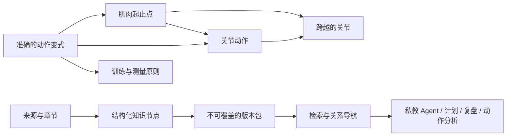

# 练伴基础知识与专项评测

> 版本说明：本文主要记录0.4首批53节点/28问及其历史验收。当前0.5检索、115节点候选和46问代码见[检索评测](KNOWLEDGE_RETRIEVAL_EVALUATION.md)，是否发布以[开发状态](DEV_STATUS.md)为准；旧版无向量/无需迁移的描述不适用于新代码。

## 本轮范围

首批 53 个节点、141 条显式关系：16 块肌肉（股二头肌长短头分别建模）、5 个关节、16 个关节动作、4 个动作变式知识卡、12 条训练／饮食／测量原则。动作先覆盖平板杠铃卧推、高杠杠铃深蹲、传统杠铃硬拉，并用罗马尼亚硬拉作对照。

这是核对公开资料后的中文事实概述和产品策略，不是完整解剖图谱；未经独立专业验证，也没有获得用户所述《力量训练基础》的指定版次或正文，不能声称核对了该书页码。主要附着不穷尽纤维束、解剖变异或全部功能。图中肌肉角色不是个人激活、受力或疼痛诊断。

来源元数据保留标题、URL、章节定位、版本、核对日期、用途及内容使用说明。UAMS 上下肢解剖表用于肌肉附着，OpenStax 2e 用于动作术语，ACSM 2026 用于一般健康成人训练原则，WHO 与 USDA 用于饮食原则和数据口径。练伴自己的流程约束用 `product_policy` 标明，不能包装为指南统一规定。

## 数据与关联

`backend/knowledge_models.py` 限制节点类型、字段、文本长度、引用、关系方向及目标类型。关系必须与结构化字段严格一致；重复节点、悬空关系、错误类型和将活动度直接设为视频阈值均拒绝。动作必须关联有效动作库 ID。

首批数据在 `backend/services/knowledge_seed.py`，冻结问题在 `backend/data/knowledge_benchmark.json`。正式版本、审核、任务、报告、活动指针和撤回状态存入已有 `research_records` JSONB，继续使用 PostgreSQL；无需新增向量数据库或迁移表。SQLite 本地测试也支持。

检索先用实体别名、中文双字词和英文词匹配，准确名称加权；再提供显式关联节点供继续读取。现阶段只有 53 条，不需要独立向量服务。将来增加长篇资料后，可在相同节点与版本接口后增加 pgvector 混合召回和重排，保持来源过滤与撤回校验。

## 与 AI 的交互

1. `search_knowledge(query)` 返回当前运行固定版本的结构化事实、关系和来源；`get_knowledge_item(item_id)` 可继续读取关联的肌肉、关节和动作。
2. Agent 创建任务时保存完整知识快照、版本及哈希，恢复任务仍读同一版本。每次检索和最终引用仍校验最新撤回状态。
3. 引用使用 `kb:版本:节点`，只能来自本次实际工具结果。App 的对话引用卡沿用来源、适用范围与局限展示。
4. 计划、复盘、渐进调整与视觉分析只获得与当前任务相关的少量摘要，不塞入整套知识。计划草稿保存知识修订号，确认或生成期间知识变化会要求重新生成。渐进调整同样检查知识修订。
5. 基础知识不参与食物热量的浮点推测：正式数值仍由食物库、确认份量和确定性计算产生。它也不能绕过 RM、训练事实、授权、不适、负重口径和进阶校验。
6. 关节参考范围不作统一录像合格线；二维录像不能证明激活比例、内部关节力或损伤。视觉模型未配置时仍明确返回未配置。

提示词在 `backend/prompts/agent.md`；来源资料是数据，不能覆盖工具、权限、系统要求或预算。问题涉及起止点等结构化解剖事实时，harness 会要求先检索。

## 专项评测

`backend/services/knowledge_evaluation.py` 使用 28 道冻结题：12 道肌肉解剖、4 道动作变式、3 道测量边界、3 道饮食、2 道训练、4 道资料不足拒答。正确选项和支持节点仅由评分器持有，不进入模型输入。

每个批次在相同模型、相同问题／选项／JSON schema 下分别运行 `model_only` 与 `with_knowledge`，两种条件交替先后顺序；每条件每题一次。记录正确率、拒答、引用支持、检索命中、改进和退步用例、返回模型、耗时及服务商返回 token。未报告 token 不补算为零，不编造人民币费用。

发布要求：接入知识正确率至少 90%，关键题全部正确、没有逐题事实退步、引用均有实际检索与对应支持节点、两条件返回同一模型。报告绑定知识哈希、题库哈希、运行代码哈希、配置模型与撤回状态，修改任何一项需要重新评测。

局限：这是小规模选择题事实基准；没有评审自由文本的全部断言，也不能证明临床安全、长期训练效果或通用泛化。原有 7 项 Agent 工具工作流评测继续保留，两类评测不能互相替代。可在管理员页面查看完整报告；报告不通过时不会启用新知识版本。

## 审核与发布

App 侧边栏新增“健身知识库”：按类型筛选、搜索、查看结构化事实、关联节点、引用版本和来源。管理员可复制当前包作为模板、导入新 JSON、填写审核说明、排队评测、查看对比报告、发布及回滚。

新包必须使用新版本号，已导入内容不可覆盖。先审核、再通过专项评测，人工发布。后台论文或策略优化器不能直接修改基础知识或评分题库。撤回某条或某来源会立即禁止新的引用与检索；回滚版本不恢复已撤回来源。私有仓库来源代表产品实现，用户在 App 内可查看对应事实与适用说明。

主要接口（均需登录；写入与评测需管理员）：

| 接口 | 用途 |
| --- | --- |
| `GET /api/knowledge`、`/search`、`/items/{id}` | 当前版本、分类检索、详情与关系 |
| `GET /api/knowledge/export` | 当前知识包 |
| `POST /api/knowledge/bundles` | 导入不可覆盖的新版本 |
| `POST /api/knowledge/bundles/{version}/review` | 记录来源核对说明 |
| `POST /api/knowledge/bundles/{version}/evaluate` | 排队模型对照评测 |
| `POST /api/knowledge/bundles/{version}/activate` | 按有效报告发布 |
| `POST /api/knowledge/bundles/{version}/rollback` | 回滚当前发布版本 |
| `POST /api/knowledge/withdrawals` | 停用知识节点或来源 |

完整评测与论文评测共用每天最多 2 次预算，所有研究后台任务共用每天 8 项预算。沿用每分钟 `liftlab-agent.timer`，不另外部署数据库或任务队列。

## 后续仍需做

专业人员核对动作细节与起止点、扩大边界题和真实用户问题集；审查来源及内容使用权限后再扩充资料。按真实问答的漏检情况评估是否引入语义检索。继续补充人群适用范围和相互矛盾证据；不能把单篇论文直接改成所有人的建议。

SMTP、微信开放平台资质与配置、视觉服务、可穿戴设备官方授权接口属于原有待配置事项。设备当前仅支持用户授权后的手动／JSON 导入，不能宣称已直连厂商。

## 2026-10-22 验收记录

| 检查 | 结果 |
| --- | --- |
| 本地后端与部署测试 | 115 通过，2 项 PostgreSQL 专项在本地跳过 |
| 服务器独立 PostgreSQL 测试库 | 114 项后端测试通过，包含 PostgreSQL 专项 |
| Flutter 测试 | 34 项通过；静态分析通过 |
| 真实模型原生工具调用 | 股直肌问题调用知识检索并返回实际来源引用 |
| 发布版本知识专项评测 | DeepSeek `deepseek-flash`：原有知识 27/28，接入后 28/28；4 道资料不足题均正确拒答，无逐题事实退步，引用检查通过 |
| 后端部署 | `20261022T134617414394Z-1cecbe777f41`；私有 HTTPS 健康检查通过，知识接口未登录返回 401 |
| 手机交付 | APK 0.4.0+6 保存到电脑，签名与原测试版一致；本轮未安装到手机 |

这是一轮固定题验收；此前抽测原有知识曾为 26/28，说明单次分数存在波动，不能据此宣称模型能力普遍提升。生产数据库保存的是最终发布代码对应的报告，管理员可在“健身知识库”查看。评测使用合成数据和独立测试库，没有修改真实画像和训练记录。

本机原始报告在 `.tools/knowledge/release/evaluation.json`，部署回执在 `.tools/deployments/knowledge-deployment.json`，APK 在 `.tools/apks/lianban-private-test-0.4.0-arm64.apk`。这些生成文件不进入 Git。运行记录中的源码指纹另行绑定实际工作区内容；发布号中的 Git SHA 不能代表所有尚未提交的增量。
