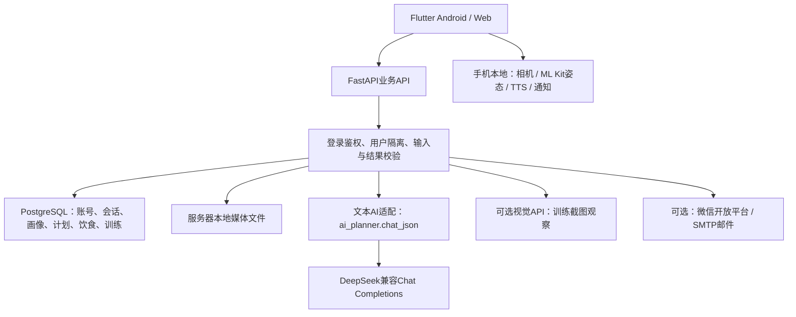

> 历史归档（2026-10-24）：内容可能过时，当前需求/实现/发布状态请从[文档索引](../INDEX.md)和[开发状态](../DEV_STATUS.md)进入。

# 练伴：当前架构、AI交互与待完成事项

## 0.3 架构更新

本项目已接入可调用业务工具的私教 Agent、来源可追溯的健康数据与研究/评测/发布闭环。最新流程、提示词位置、数据边界和配置见 [AGENT_AND_RESEARCH.md](../AGENT_AND_RESEARCH.md)。下面保留0.2阶段的详细说明，其中主聊天调用链已由新 Agent 流程取代。

0.4 基础知识层补充肌肉起止点、关节动作、三大项变式、训练与饮食原则，增加固定版本工具检索、引用校验、来源撤回及 28 题模型对照评测，详见 [FOUNDATION_KNOWLEDGE.md](../FOUNDATION_KNOWLEDGE.md)。与论文证据、用户长期记忆和食物数值库分别存储，通过上下文服务与 Agent 工具协作。

核对日期：2026-10-18。对应Android 0.2.0（versionCode 4）。本文件依据当前代码和部署验收记录，功能“已有代码”“已配置”“已真实验证”分别说明。

## 1. 架构总览



### 技术与部署

| 层 | 当前实现 | 代码入口 |
|---|---|---|
| App | Flutter/Dart，共用Android和Web业务页面 | `mobile/lib/app.dart`、`auth/auth_gate.dart` |
| 后端 | Python、FastAPI、Pydantic、httpx；单体应用 | `backend/app.py` |
| 数据库 | SQLAlchemy + PostgreSQL 16；Alembic迁移；SQLite供本地开发 | `backend/database.py`、`backend/migrations/` |
| 文本AI | HTTPS Chat Completions，要求JSON返回 | `backend/ai_planner.py` |
| 实时陪训 | camera图像流、Google ML Kit姿态检测、关节角度状态机、Flutter TTS | `mobile/lib/live/` |
| 提醒 | Android/iOS本地通知；Web前台提醒 | `mobile/lib/reminders/` |
| 云端 | 华为云Ubuntu 24.04、systemd、Uvicorn一个worker；数据库与后端仅监听本机 | `deploy/linux/` |
| 当前手机入口 | Tailscale私有HTTPS → 后端；无需USB转发 | `docs/PRIVATE_MOBILE_TEST.md` |
| 正式入口 | 预留`api.lianbanfit.top`和Caddy；备案及公网HTTPS未完成 | `docs/DOMAIN_SETUP.md` |

当前未引入Redis、任务队列、向量数据库或微服务。AI使用显式业务流程：组装资料→模型生成JSON→后端核验→保存；聊天模型没有任意调用业务工具的权限。

### 数据如何保存

- 账号、微信身份、会话、刷新令牌、验证码、邮件队列、限流桶分别有关系表。
- 业务记录集中在`user_records`：`user_id + kind + id + payload(JSONB)`，按类型存画像、对话、RM、计划、训练、饮食、媒体元数据、进阶事件。计划是不可变版本，编辑或进阶创建新记录。
- 食物与动作在共享`catalog_items_v2`中；普通用户只读，管理员维护。初始化包含44条食物、38个动作。
- 用户隔离由服务端鉴权上下文及查询条件实现；当前没有PostgreSQL行级安全策略（RLS）。关键写入锁定用户，模型调用结束后再检查资料修订号，避免覆盖较新的事实。
- 上传文件存服务器`uploads`目录，数据库记录所属用户和文件引用；不存数据库BLOB，目前没有对象存储。

## 2. AI的统一调用方式

文本AI统一由`ai_planner.chat_json()`调用`${AI_BASE_URL}/chat/completions`，配置为`AI_API_KEY`、`AI_BASE_URL`、`AI_MODEL`。云端现用DeepSeek、`deepseek-flash`；这个模型标识是部署配置，切换服务时按实际可用模型调整。

- 手机只访问自己的后端，供应商密钥留在服务器。
- 请求包含`messages`、`response_format={"type":"json_object"}`和输出长度限制；官方DeepSeek地址显式关闭thinking。
- 使用完整JSON响应，当前没有流式逐字返回。连接超时15秒、整个供应商请求超时90秒。
- 输出先解析JSON，再由Pydantic和业务规则检查。缺少配置、超时、额度不足、输出不合格均返回明确错误；训练事实保存和AI生成分开处理。
- 常规一次聊天调用模型一次；生成一份计划调用一次；一次训练保存后通常再调用两次，分别生成复盘、评估下次目标。不需要调整的早期场景可以直接返回保持原因。
- 对话、计划、视觉观察、复盘已经纳入每用户6次/分钟、100次/天和一个并发AI请求限制。**新进阶接口`/progression`尚未纳入该统一限制，公开测试前应补齐。**当前也未按token统计费用或设置人民币预算。

## 3. 私教聊天与画像提取

入口：`POST /api/coach/messages`，实现位于`backend/coach.py`。

### 一次请求发送什么

1. system：共同私教提示词 + 当前教练性格提示词。
2. system：已知画像、画像字段Schema、输出Schema和健身上下文。
3. 最近12轮对话，历史教练身份有标记。
4. user：本次用户消息。

上下文由`app.coach_context()`组装，包括当天饮食与目标、RM、当前计划、训练档案、近期训练、提醒设置、动作库概要，以及消息中提到的最多3个动作的完整要点。动作选择目前通过名称/别名匹配，没有语义向量检索。

### 模型返回与写入

```json
{
  "reply": "面向用户的回复",
  "profile_updates": [
    {"field": "session_minutes", "value": 60, "evidence": "每次能练60分钟"}
  ]
}
```

后端核验字段、数值范围、枚举和本次消息中真实存在的原文证据，再把事实合并入画像。问题、假设、他人资料和AI建议不能直接成为用户事实。同请求编号防止重复保存，资料并发变化返回409。

**能力边界：**当前聊天可更新画像并提供建议。保存饮食、录RM、确认计划、记录训练、开启通知仍由对应页面/API执行；聊天不能声称已完成这些操作。训练档案从用户确认记录动态汇总，AI复盘作为建议独立保存，不自动成为RM或经验等级。

## 4. 首次引导与训练计划

客户端`fitness_onboarding.dart`读取`GET /api/onboarding`，未完成引导时进入画像表单；保存画像后自动请求`POST /api/plans/generate`，展示草稿，用户确认后`POST /api/plans`并完成引导。

生成输入包含基础身体资料、目标、经验、训练月数、具体每周训练日、开始时间、单次可用分钟数、器械、偏好、恢复、睡眠、伤病与可训练范围、有效RM、已确认训练档案和可选动作Schema。

结果包括：2–12周周期（默认4周）、逐周阶段说明、可执行的一周安排、重量/组数/次数/休息、热身、恢复、制定理由、进阶建议和风险提示。

服务端检查训练日数量、动作ID与变式、重复动作、RM参考上限及估算用时。缺少可靠RM的动作重量置空，不能从体重或年龄猜测。历史伤病不统一阻断评估，单独提示风险并限制到已提供的可训练范围；本次实际疼痛不能成为强行加重的依据。

草稿记录画像、RM、训练档案和当前计划快照；确认时复核，发生变化需重新生成。当前计划可手动编辑，保存新版本。整体周期目前是“一周执行结构 + 每周阶段说明 + 训练后动态调整”，没有预先生成每一周每一组的完整独立负荷表。

## 5. 训练记录、复盘与渐进超负荷

`POST /api/workouts`先保存用户确认的逐组重量、次数、RPE、不适、恢复、关联计划及训练日，形成画像的训练档案。

- `/workouts/{id}/review`：性格提示词 + 复盘提示词 + 本次记录、历史、画像、RM及动作技术要点，返回总结、完成亮点和下一次建议。没有影像证据时不得声称看过动作。
- `/workouts/{id}/progression`：独立提示词 + 画像、当前计划、可靠RM、本次/上次同训练日表现和恢复，返回保持原因或具体动作的下一次重量/次数。

进阶结果由程序再次约束：两个不同日期的同训练日均达标、两次RPE不高于8、恢复不差才能增加；一次只改变重量或次数，最多加5%重量或每组1次。加重还需有效RM和器械增量。疲劳或高RPE可以有依据地减量；本次疼痛动作不自动调整。组数和休息不由此接口自动修改。

有效变化创建新计划版本和`plan_change`事件，显示原目标→下次目标、原因、来源记录，最近一次可撤销；重复请求不重复加重，补录和旧计划训练不覆盖较新的安排。本轮训练日全部完成后推进周次，最终周结束提示生成并确认新周期。自动进阶约束是产品规则，尚未通过训练效果或伤病人群临床验证。

## 6. 饮食、实时陪训与视觉观察

### 当天饮食

食物库数值×用户确认的克重，计算能量、蛋白质、碳水、脂肪，按早餐/午餐/晚餐/加餐汇总并与画像公式目标比较。当前目标采用基础代谢估算、固定活动系数1.4及目标热量偏移，未接入自适应活动消耗模型。

**餐食照片：目前只有上传存储。**上传接口返回`awaiting_integration`，还缺照片识别、混合菜份量估算、营养库匹配、用户纠正与确认写入流程。配置`VISION_*`不会自动完成这项功能。

### 手机实时陪训

相机帧在手机用ML Kit提取关节点，`CoachingEngine`检查关键点置信度、入框、时间连续性，再按肘/膝/髋角度状态机实验计次；提供卧推、深蹲、硬拉的侧面机位指引和取景框。TTS播报计次、取景提示及可选节奏提示，设有冷却和过期画面保护。

当前图像流每100毫秒最多进入一次处理，实际速度取决于设备。姿态推理在手机本地执行，当前实时流程不上传完整视频，也没有调用云端视觉模型持续纠错。

尚不能可靠判断杠铃轨迹、腰椎/肩胛细节、真实受力、多人身份或动作是否安全；尚未建立经过标注数据验证的动作错误检测器。ML Kit姿态模型可直接使用，具体三大项纠错需要设计特征、规则/分类器并用真实标注数据验证，不能把现有计次阈值当作质量判定标准。

### 训练截图观察

动作库页面可选择2–6张截图和视角，调用`POST /api/movement/analyze`。服务端使用独立的`VISION_API_KEY`、`VISION_BASE_URL`、`VISION_MODEL`连接支持图片输入和JSON输出的模型。

提示资料来自`exercise_content.analysis_context()`，与动作库共用关节动作、训练部位、技术要点、错误观察点和内容版本/hash。只允许适合当前视角/截图数的`cue_id`，每项需要证据及截图索引，结果标为实验观察；看不清时返回证据不足。当前视觉服务未配置，也未做真实模型准确率验收。

动作示意GIF为参考演示；《力量训练基础》全文、具体版本和页码目前未完成核验，资料标记`draft_not_validated`，不能声称已获该书完整验证。

## 7. 提示词清单

| 用途 | 源位置 | 主要要求 |
|---|---|---|
| 私教共同规则 | `backend/prompts/fitness_coach.md` | 身份、交流方式、只基于证据更新画像、操作边界、JSON格式 |
| 阿衡：稳健 | `backend/prompts/coaches/steady.md` | 耐心、稳定习惯、小步积累 |
| 小燃：活力 | `backend/prompts/coaches/energetic.md` | 轻快鼓励、具体小目标、尊重休息 |
| 阿策：理性 | `backend/prompts/coaches/analytical.md` | 依据、数据与估算区分、不确定性 |
| 棉棉：温柔 | `backend/prompts/coaches/gentle.md` | 尊重自主选择、可持续、避免补偿训练 |
| 周期计划 | `backend/ai_planner.py::generate` | 时间、器械、力量、周期、风险及负荷规则 |
| 训练复盘 | `backend/workouts.py::router/review` | 只使用确认事实，技术要点作参考，建议与事实分离 |
| 训练后进阶 | `backend/progression.py::router/progress` | 达标、RPE、恢复、加重/次数/减量限制 |
| 截图视觉观察 | `backend/exercise_content.py::SYSTEM_PROMPT` | 只报可见证据、允许观察点、截图索引、不作安全保证 |

登录后`GET /api/coach/prompt?coach_id=steady`可查看实际共同提示词与性格组合。其他任务提示词目前内嵌Python，尚无统一提示词管理平台、灰度或A/B评测；没有统一记录每种任务的提示词版本、用量和费用。改变提示词需要代码部署并回归。

## 8. 当前配置与验证状态

| 项目 | 当前状态 | 还需做什么 |
|---|---|---|
| PostgreSQL、账号和数据隔离 | 已部署；独立测试库及隔离测试通过 | 多用户负载、连接池、磁盘容量与恢复演练持续验证 |
| 文本AI | DeepSeek已配置；真实聊天、周期计划和首次训练后保持负荷已联调 | 建立固定画像/力量/伤病样本集，重复生成检查质量、耗时与费用 |
| Android正式包 | 0.2.0已安装，登录与首次画像引导实测通过 | 用户真实完整训练→复盘→加次数/重量→撤销→跨周的手机验收 |
| 私有HTTPS | Tailscale可访问，TLS、401及APK下载已核验 | 正式发布完成备案、Caddy公网证书、手机域名切换；不依赖测试VPN |
| SMTP邮箱注册/找回 | 接口及模拟SMTP测试通过；云端未配置 | 配置SMTP及发件身份，测试真实验证码、垃圾箱、失败重试及找回流程 |
| 微信OAuth | 移动端SDK和后端state/凭据交换/绑定代码与模拟测试已有；未配置 | 取得适用的开放平台资质与移动应用AppID/AppSecret，匹配包名/签名，真机授权/取消/绑定验证 |
| 视觉模型 | 训练截图接口已有；云端未配置 | 选定模型并配置`VISION_*`，真实图片、不同视角及误报漏报评测 |
| 餐食识别 | 尚未实现 | 识别模型、份量校准、营养库匹配、用户确认与实拍样本集 |
| 实时动作纠错 | 本地姿态、机位、计次及语音已有 | 三大项、多角度、遮挡、多人、光线、不同体型、机型及耳机延迟验证；建立标注与准确率门槛 |
| 提醒 | 本地通知已接入，设置保存与基础测试通过 | 荣耀等机型锁屏、重启、后台限制、通知权限、退出账号与多账号隔离验收 |
| iOS | 共用代码与配置已有 | macOS/Xcode构建、签名及真实设备验证 |

### 公开测试前优先项

1. 补齐进阶接口AI限流/并发限制；记录供应商用量、耗时、错误和每日费用上限。
2. 训练进阶做长期数据回放：同日多次、漏练、回退、改计划、数据补录、恢复变差、疼痛、RM过期及多设备并发。当前周期周次按完成训练轮次推进，需确认产品预期与用户理解。
3. 当前媒体上传主要检查MIME和大小，补真实内容解码、配额、保存期限、账号删除后的文件清理及备份删除策略。公开前完成隐私文本中的运营主体、联系方式、数据流和第三方清单；模型调用会把相关画像和记录发给供应商。
4. 大量业务仍在`app.py`与客户端`app.dart`，持续开发宜拆分业务服务/页面；JSONB模型逐步增加明确的版本和迁移策略。Web持久登录还需HttpOnly Cookie/CSRF设计。
5. 自动化发布、定期恢复演练、服务错误监控和容量告警尚需完善；当前部署与APK发布主要靠脚本操作，未配置GitHub Actions持续集成。

最近验收：本地后端及部署测试87项通过、2项因缺少本地PostgreSQL跳过；服务器一次性PostgreSQL库86项后端测试通过；Flutter 30项测试及静态分析通过。以上是具体已验证范围，不代表真实视觉准确率或长期训练效果已经验证。详细部署与真机记录见`PRIVATE_MOBILE_TEST.md`。
